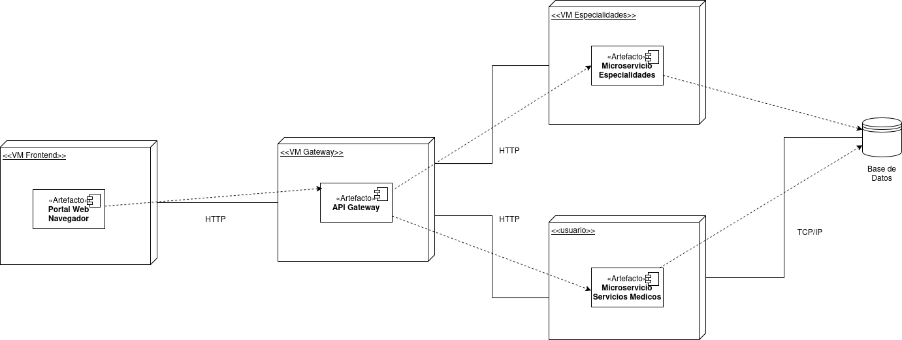

# Arquitectura de Despliegue

## Resumen

La arquitectura se compone de un `frontend`, un `gateway` y dos microservicios:
`servicios-medicos` y `especialidades`. El frontend consume al gateway y este enruta
las solicitudes hacia los microservicios usando configuracion inyectada por entorno,
evitando IPs hardcodeadas dentro de las imagenes.

En el despliegue en nube:

- Terraform aprovisiona la infraestructura base en GCP.
- Cloud SQL concentra la persistencia PostgreSQL gestionada.
- Ansible distribuye archivos `.env`, archivos Compose y levanta los contenedores.

Esta organizacion permite recrear el despliegue con cambios minimos entre entorno local
y entorno cloud.
