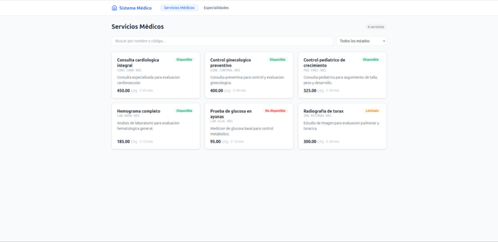
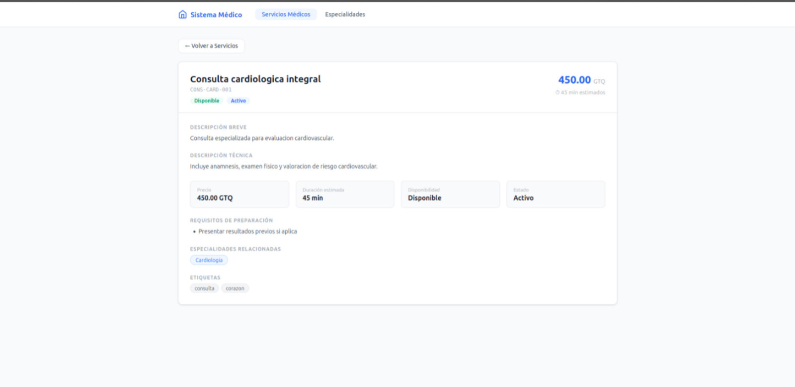
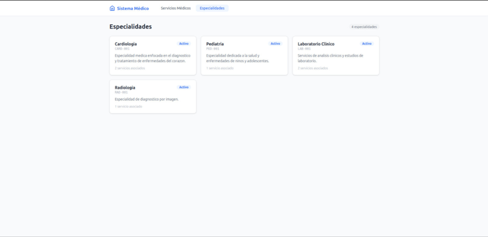
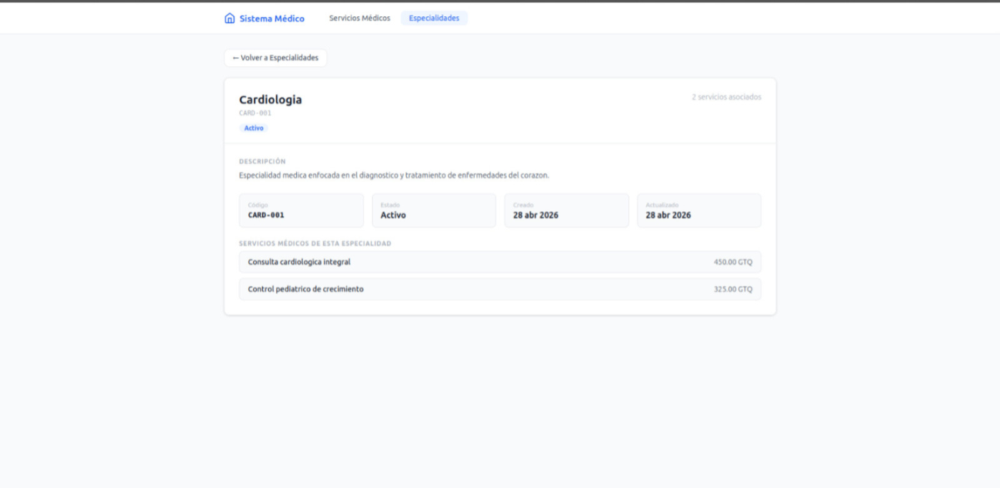

# Manual de Usuario

## ¿Qué es el sistema?
Esta plataforma te ayuda a consultar **servicios médicos** y **especialidades** de forma rápida. Puedes ver listas, buscar y abrir el detalle de cada registro.

## Requisitos
- Tener acceso al sistema desde un navegador.
- Conexión a internet.

## Ingreso al sistema
1. Abre tu navegador.
2. Ingresa la URL: http://136.115.21.29/.
3. Verás la pantalla principal con dos secciones: **Servicios Médicos** y **Especialidades**.

## Pantalla principal
En la parte superior encontrarás las pestañas para cambiar entre **Servicios Médicos** y **Especialidades**.

## Servicios Médicos
En esta sección puedes:
- Ver la lista de servicios disponibles.
- Buscar por nombre o código.
- Filtrar por estado (disponible, limitado o no disponible).

Para ver un servicio, haz clic en su tarjeta. Se abrirá su detalle con precio, estado y descripción.

## Especialidades
En esta sección puedes:
- Ver la lista de especialidades.
- Abrir el detalle de cada una.

Al abrir una especialidad, verás su información y los servicios relacionados.

## Consejos rápidos
- Si algo no carga, prueba actualizar la página.