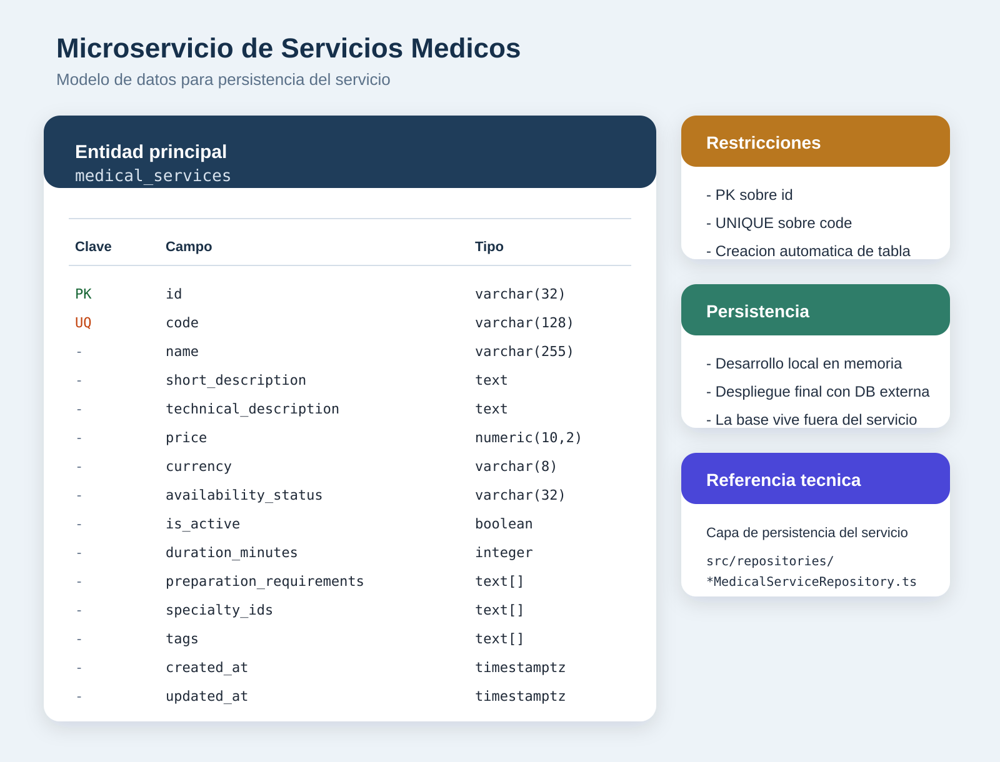

# Modelo de Datos del Microservicio de Servicios Medicos

## Descripcion

Este documento resume el modelo de datos del microservicio de Servicios Medicos para
su capa de persistencia desacoplada.

## Imagen del modelo

## Tabla utilizada

- `public.medical_services`

Si se define otro esquema mediante `DATABASE_SCHEMA`, la tabla pasa a ser:

- `${DATABASE_SCHEMA}.medical_services`

## Notas importantes

- La base de datos es externa al microservicio.
- El servicio no levanta PostgreSQL dentro del contenedor.
- El microservicio crea automaticamente la tabla si no existe.
- Si la tabla esta vacia, inserta datos semilla para pruebas e integracion.
